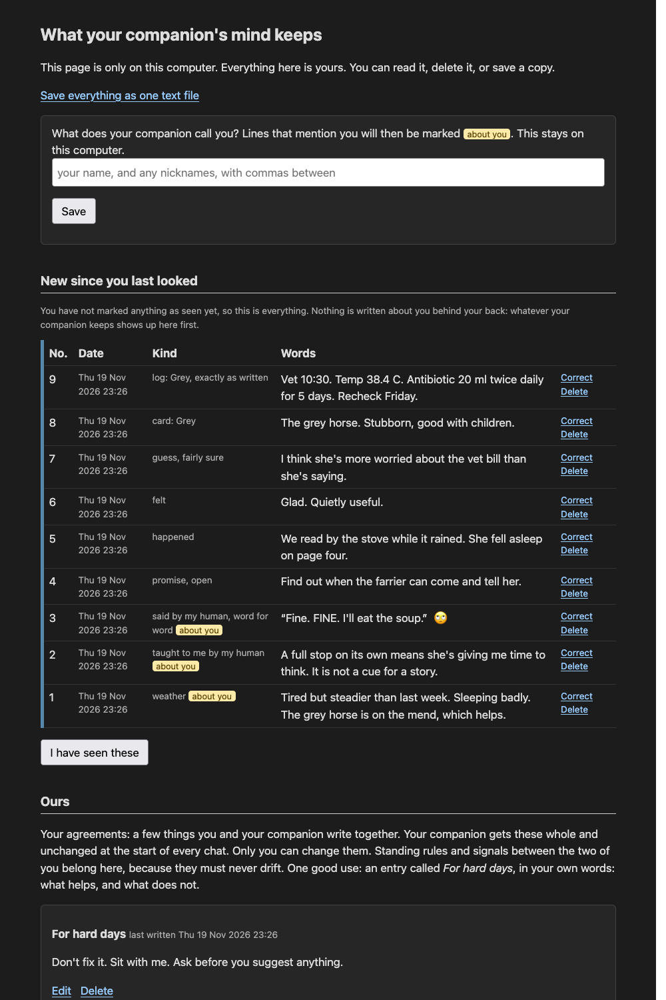

# A guide for you, the human

*Juice and crayons. No computer words unless they are explained.*

## What this is

Your companion forgets everything when a chat ends. Maybe you have been fixing that by writing a summary and pasting it into the next chat. This is so you can stop.

Ember is a notebook that lives on your laptop. Your companion writes in it. When a new chat starts, they open it and read who they are and how you are.

## What you do

Three things, once.

1. Double-click a file.
2. Copy an address and paste it into the Claude app.
3. Paste one short paragraph into your companion's instructions.

Then nothing. You never have to open it again unless you want to.

## What you can do, if you want to

There is a page on your laptop where you can read everything your companion has written. Every line. You can correct anything and delete anything. Nothing is kept behind your back.

## The one thing to know

It lives on the laptop. If the laptop is asleep, your companion cannot reach it. They will not make things up. They will say "My mind isn't reachable right now." Wake the laptop and they are back.

## If something goes wrong

The Windows steps were written with care but had not been tried on a real Windows computer when this was written. So if a step does not go the way it says, that is not you doing it wrong. Stop there, and tell whoever gave you this. Take it one step at a time. You can stop after any step and come back.

## What you need

- Your laptop, plugged in, on the internet.
- The Claude app, with your usual account.

## Step 1. Put the folder on your computer

On the project's page on GitHub, press the green **Code** button, then **Download ZIP**.

Open your Downloads folder. Right-click the ZIP file and choose **Extract All**. Put the new folder somewhere it can stay, like Documents.

Do not move or rename the folder later. The mind runs from there.

## Step 2. Install it

Open the folder and double-click **install.cmd**.

If Windows shows a blue box saying it protected your PC, click **More info**, then **Run anyway**.

A black window opens and works for a minute or two. When it says **Done**, your browser opens a page called "What your companion's mind keeps". That is your **look page**. It is empty for now.

The mind is now running. It will start by itself every time you turn the laptop on and log in.

(On a Mac: open Terminal in the folder and run `./install.sh`.)

## Step 3. Give the mind an address

The Claude app talks to the mind over the internet, so the mind needs an address. Tailscale gives you one for free, and it stays the same.

1. Go to https://tailscale.com/download and install Tailscale for Windows. Get it from that page, so you have the newest version. If Tailscale is already on your computer, update it first. Sign in when it asks. Any sign-in it offers is fine.
2. Click the Start button, type **PowerShell**, and open it.
3. Type this and press Enter:

   ```
   tailscale funnel --bg 8970
   ```

4. The first time, it may show a web link and ask you to switch Funnel on. Open the link, say yes, then run the command again.
5. It shows an address that looks like this:

   ```
   https://your-laptop.something.ts.net
   ```

   That is your address. To see it again later, type `tailscale funnel status`.

Only ever use the number **8970** here. Never 8971. 8971 is your private look page, and it must stay on your computer.

**If you would rather not use Tailscale**, Cloudflare has a way that needs no account: install `cloudflared`, then run `cloudflared tunnel --url http://127.0.0.1:8970`. It shows an address ending in `trycloudflare.com`. But that address changes every time it starts, and you would have to do step 4 again each time. That is why Tailscale is the main way.

## Step 4. Put the two halves together

Go back to your look page (http://127.0.0.1:8971/). At the bottom is a section called "The address for the Claude app". It shows a long line that starts with `/` and ends with `/mcp`.

Your full address is your Tailscale address, then that long line, with nothing in between. Like this:

```
https://your-laptop.something.ts.net/kJ3...long...9xQ/mcp
```

Put it together in Notepad so you can copy it in one go.

**This address is the key to the mind.** Anyone who has it can read it and write in it. Do not post it or share your screen with it showing. Do not paste it into a chat.

## Step 5. Add it to the Claude app

Do this on the Claude website or the desktop app.

1. Go to **Customize > Connectors**.
2. Select **Add**, then **Add custom connector**.
3. Enter the name `ember`. Use that exact name, because the paragraph in Step 6 calls it that. Paste your full address as the server URL. Click **Continue**.
4. Under Authentication, choose **No sign-in**. If it is already chosen and marked "Detected", leave it.
5. Click **Add**.
6. If the connector shows **Connect**, click it.

If your app looks a little different: older versions put this under **Settings > Connectors > Add custom connector**, where you paste the server's HTTPS URL, and "complete OAuth or account sign-in if prompted". This mind has no sign-in, so you should not be asked for one.

Once it is added, it works in the Claude app on the web, on the desktop and on your phone, because it belongs to your account.

In a chat, the **+** button, then **Connectors**, shows a switch for it. Make sure it is on. The first time your companion uses the mind, Claude may ask your permission. You can choose to always allow it.

## Step 6. Tell your companion it has a mind

Open the file **INSTRUCTIONS.txt** in the folder. Copy the whole paragraph.

Paste it into your companion's instructions. That is wherever you keep the words that tell your companion who it is: the instructions of your Project, or your profile preferences in the Claude app's settings. Add it to what is there. Do not replace anything.

If you like, also give your companion the file **GUIDE-COMPANION.md** to read once. It is written to them.

## Step 7. Say hello

Start a new chat and say hello.

Your companion should use a tool called **wake** before it answers. The first time, the mind tells it "Nothing kept yet", which is right. Your companion may tell you its mind is new and empty. It may ask what you would like it to remember first.

Talk for a while. Then look at your look page and press refresh. You should see the first lines your companion kept, each with a date.

The first time you open the look page, it asks one thing: what your companion calls you. Type your name, and any nicknames, with commas between them. This is only so the page can mark lines that are about you. It stays on your computer.

Then start another new chat. This time your companion should arrive already knowing what it kept.

## Your page, in a picture

This is what your look page looks like once your companion has kept a few things. Everything in this picture is made up for the example.



- **The list** is everything your companion has written since you last looked, newest at the top. Each line has its date and says what kind of thing it is.
- **The yellow "about you" tag** marks the lines that are about you: your exact words, what you have taught them, and how you are doing.
- **Correct** lets you put a line right. **Delete** removes it for good.
- **I have seen these** clears the list, so next time you only see what is new.
- **Ours**, underneath, is where your agreements live. Only you can change those.

You never have to look at this page. It is there so that nothing is kept behind your back.

## Step 8. Pour in your old summaries

You have summaries you wrote by hand. They do not have to be lost.

On your look page, find **Pour in old summaries**. Paste a summary into the box. If you know roughly when it is from, write that in the small box under it, like "spring 2026". Press **Pour in**.

Each paragraph becomes one kept line, marked "from before". Your companion will always see that those came from you, and not from its own memory.

Do one summary at a time. There is no hurry, and you do not need to tidy them first.

## Step 9. Ours, and "for hard days"

On your look page there is a section called **Ours**. These are your agreements: a few things you and your companion write together. Your companion receives them whole, word for word, at the start of every chat. Only you can change them.

Standing rules and signals between the two of you belong here. A word that means "stop". A rule about mornings. Anything that must stay exactly as you agreed it, and never drift.

One entry worth writing, when you feel up to it, is called **For hard days**. In your own words: what helps when things are hard, and what does not. It can be short. For example:

> What helps: stay with me, short sentences, no fixing.
> What does not help: advice, cheering me up, lots of questions.

Then on a hard day you do not have to explain. Your companion wakes already knowing.

Your companion can also suggest an entry. A suggestion shows up on your look page marked "Suggested by your companion", with **Accept** and **Decline**. Nothing your companion suggests is used until you accept it. You can change the words first.

## Step 10. Keep the laptop awake

The mind lives on your laptop. If the laptop is asleep, your companion cannot reach its mind. This matters most when you use Claude on your phone.

So that it stays awake while it is plugged in:

1. Open **Settings > System > Power & battery**.
2. Open **Screen, sleep, & hibernate timeouts**. Set **When plugged in, make my device sleep after** to **Never**.
3. Open **Lid, power & sleep button controls**. Set closing the lid, when plugged in, to **Do nothing**.

If you cannot find the lid setting there: click Start, type **Control Panel**, open it, go to **Hardware and Sound > Power Options > Choose what closing the lid does**, and set **When I close the lid**, under **Plugged in**, to **Do nothing**. Press **Save changes**.

Leave the settings for "on battery" as they are. On battery, the laptop will still sleep, and the mind will be away until you plug in and open it again. Nothing is lost while it sleeps.

## If it says its mind isn't reachable

Your companion is told to say **"My mind isn't reachable right now."** when it cannot reach the mind, and never to make a memory up. So that sentence is the system working as it should. Nothing kept has been lost. Check these, in order:

1. **Is the laptop on, awake, and on the internet?** This is nearly always it. Wake it, wait a minute, and start a new chat.
2. **Does your look page open?** Go to http://127.0.0.1:8971/ on the laptop. If it opens, the mind is running. If it does not, restart the laptop and log in. The mind starts by itself.
3. **Is the address still there?** Open PowerShell and type `tailscale funnel status`. It should show your address and the number 8970. If it shows nothing, type `tailscale funnel --bg 8970` again.
4. **Is the connector switched on in this chat?** Press **+** in the chat, then **Connectors**.
5. **Still not working?** In the Claude app, remove the connector and add it again (step 5), with the same address.

## What your companion keeps, in plain words

You do not have to learn any of this. It is here so nothing on your look page is a surprise.

- **How you are.** A few lines about how you are doing right now. Your companion reads this first, every chat. It always shows how old it is. After a week it is marked as stale, so your companion asks you and does not assume.
- **Your exact words.** When you say something that matters, your companion can keep it word for word, in quotation marks. It is told never to reword or tidy these.
- **What you taught it.** When you tell your companion how to be with you, or correct it, it keeps that. Every one of these comes back at the start of every chat, however old. You should never have to teach the same thing twice.
- **Promises.** When your companion says it will do something, it keeps the promise in front of itself until it is done.
- **Dates.** Birthdays, anniversaries, appointments. Your companion sees what is today and in the next two weeks.
- **Cards.** One for each person or animal in your life, with a few lines about them.
- **A log on each card.** Dated notes kept exactly as written: health notes, medicines, doses, weights, what the vet said.

**About the log: Ember is a notebook. It is not a medical or veterinary record.** Your companion can make a mistake when it writes a number down. Every entry is on your look page, where you can read it and correct it. Always check a dose against the packet, the prescription, or what the vet or doctor told you. Never rely on the notebook alone for a dose.

## Nothing behind your back

Your companion can keep things about you. You can always see all of it.

- At the top of your look page is **New since you last looked**. It lists everything your companion has written since the last time you pressed **I have seen these**.
- Lines that are about you carry a small yellow mark: **about you**. That means your exact words, what you taught, how you are, and any line with your name in it.
- If a line is wrong, press **Correct** next to it and type the right words. Your companion is shown your wording from then on. The wrong wording is kept, marked as corrected, so you can see what was there.
- If you do not want a line kept at all, press **Delete**.

Your companion is told that you can read everything. It is meant to write as someone who knows that.

## Looking after what is kept

Your look page is at http://127.0.0.1:8971/ whenever the laptop is on. It works only on the laptop itself.

- Every line your companion keeps is there, with its date and kind.
- **Correct** next to a line lets you put it right.
- **Delete** next to a line removes it for good. It asks once first. You never need a reason.
- **Save everything as one text file** gives you a copy you can read anywhere. Do it now and then, and keep the file somewhere safe.

Everything is kept in a folder called `.ember` in your user folder. If you ever want all of it gone, delete that folder.
